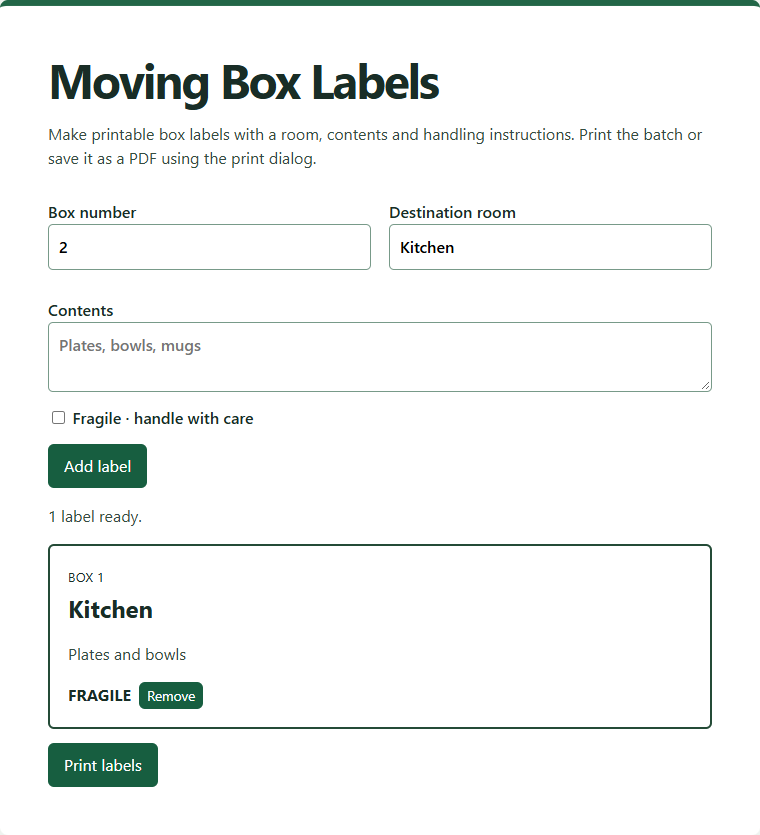

# Moving Box Labels

Make printable box labels with a room, contents and handling instructions. Print the batch or save it as a PDF using the print dialog.

Download `index.html` and open it in your browser. It works offline with no account or installation. Data stays in the open tab. Export or print before closing the tab.

## Example

Enter box 1, Kitchen, Plates and bowls. Select Fragile, add the label, then print. Remove a label to correct it before printing.
